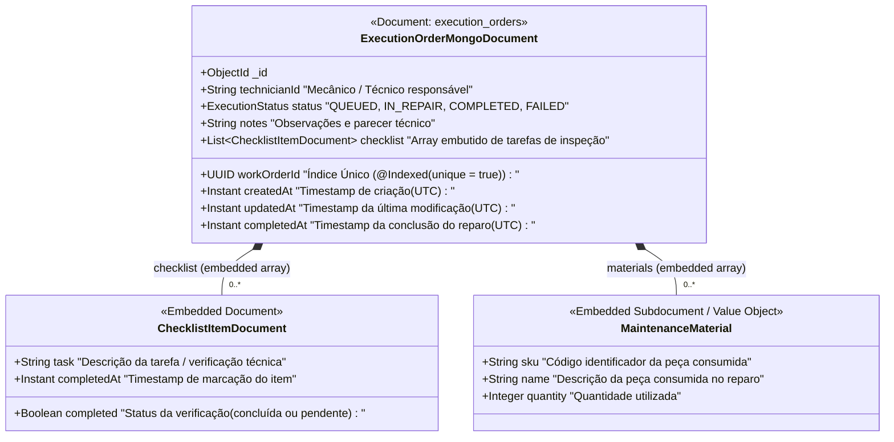

# ADR 0002: Adoção do MongoDB NoSQL (`exec_db`) para Dinamismo Operacional, Checklists Sem Esquema Rígido e Fila de Oficina

* **Status**: Aceito (Accepted)
* **Data**: 2026-10-02
* **Escopo**: Microsserviço de Execução de Oficina (`15soat-phase4-api-exec`)
* **Herança Arquitetural**: Especializa a **[ADR 0001 da `15soat-phase4-lib-commons`](../../../15soat-phase4-lib-commons/docs/adr/0001-database-per-service-and-polyglot-persistence.md)** (Padrão Database-per-Service e Persistência Poliglota)
* **Autores**: FIAP SOAT Tech Challenge Team
* **Decisores Técnicos**: Equipe de Arquitetura e Engenharia de Software

---

## 1. Contexto e Declaração do Problema

O microsserviço `15soat-phase4-api-exec` gerencia as atividades operacionais da oficina mecânica (*chão de fábrica*). Suas atribuições compreendem a ordenação e despacho da fila de reparos, o diagnóstico técnico preliminar, o preenchimento de checklists de inspeção veicular (ex: suspensão, alinhamento, fluídos, sistema elétrico, freios), o apontamento de peças/materiais efetivamente consumidos no conserto e a finalização da execução física do serviço.

A natureza desse domínio difere substancialmente dos fluxos estritamente relacionais de faturamento e cadastro:
1. **Heterogeneidade Extrema de Checklists**: Cada montadora, modelo de veículo ou categoria de serviço (manutenção preventiva, revisão ou funilaria) possui um conjunto dinâmico de itens de inspeção e laudos técnicos. Forçar essa estrutura em um modelo relacional normalizado levaria inevitavelmente ao anti-pattern **EAV (Entity-Attribute-Value)** com tabelas genéricas e de difícil manutenção, ou exigiria alterações constantes de schema DDL no banco de dados.
2. **Leituras Atômicas e Agregado Completo**: O mecânico na bancada de trabalho precisa carregar a ficha de execução completa de um veículo (dados operacionais, checklists, status de cada item e peças consumidas) em uma **única operação atômica de I/O**, sem a necessidade de múltiplos `JOIN`s relacionais custosos.
3. **Escrita Rápida e Frequente de Apontamentos**: Atualizações incrementais de tarefas durante o conserto exigem alta vazão de escrita e baixa latência de persistência.
4. **Isolamento de Falhas da Oficina**: A indisponibilidade eventual de bancos relacionais de suporte comercial não pode interromper os mecânicos em serviço na oficina física.

---

## 2. Decisão Arquitetural

Decidimos adotar o **MongoDB** como o sistema de banco de dados NoSQL orientado a documentos exclusivo do microsserviço `15soat-phase4-api-exec`, operando sob a base isolada **`exec_db`**:

1. **Padrão Database-per-Service e Modelo Orientado a Documentos**:
   - O `exec_db` armazena o agregado de negócio `ExecutionOrderMongoDocument` como um documento BSON rico e autocontido na coleção `execution_orders`. O banco é fisicamente isolado dos bancos relacionais (`work_order_db` e `billing_db`), com acesso restrito via credenciais exclusivas do microsserviço de execução.
2. **Documentos Embutidos (*Embedded Documents*) para Checklist e Materiais**:
   - As coleções de itens de checklist (`checklist`) e materiais apontados (`materials`) são persistidas **embutidas diretamente no documento raiz** da ordem de execução:
     - `ChecklistItemDocument`: Representa a verificação técnica com `task`, `completed` e `completedAt`.
     - `MaintenanceMaterial`: Representa a peça consumida na baia com `sku`, `name` e `quantity`.
   - Isso garante integridade atômica no nível de documento (operações atômicas em documento único no MongoDB), eliminando transações distribuídas locais e simplificando consultas.
3. **Indexação Estratégica para Fila de Oficina**:
   - Criação de índice único em `workOrderId` (`@Indexed(unique = true)`) para busca imediata e prevenção de duplicações da ordem de serviço.
   - Criação de índice secundário simples em `status` (`@Indexed`) para suportar a filtragem ultrarrápida da fila de trabalho dos mecânicos (`QUEUED`, `IN_REPAIR`, `COMPLETED`, `FAILED`).
4. **Evolução de Esquema sem Migrações DDL Bloqueantes (*Schema Flexibility*)**:
   - O MongoDB permite que checklists recebam novos atributos de forma dinâmica, sem necessidade de paradas programadas para migrações DDL.
5. **Drivers e Integração Spring Data MongoDB**:
   - Persistência implementada através de repositórios do Spring Data MongoDB (`SpringDataExecutionOrderRepository`) com mapeamentos de Domain Objects puros, garantindo desacoplamento entre modelo de domínio e representação física BSON.

---

## 3. Diagrama de Estrutura de Documentos NoSQL

---

## 4. Consequências

### Positivas
- **Flexibilidade e Evolução Dinâmica**: A oficina pode introduzir novos tipos de inspeção e parâmetros veiculares instantaneamente sem refatorar o banco de dados.
- **Desempenho de Leitura de Agregado**: Um único `findByWorkOrderId(workOrderId)` recupera todo o estado operacional do veículo instantaneamente, otimizando as chamadas da UI do mecânico.
- **Atomicidade Nativa em Documento Único**: Modificações no status da execução, no array de checklist e nas peças consumidas são comitadas atomicamente no documento sem o overhead de transações multi-tabela.
- **Escalabilidade Horizontal Natural**: O modelo de documentos do MongoDB possui suporte nativo a sharding e replicação em alta disponibilidade (*Replica Sets*).

### Trade-offs & Mitigações
- **Ausência de Integridade Referencial por Foreign Keys**: O MongoDB não valida a existência do `sku` ou do `workOrderId` no banco relacional. *Mitigação*: A validação de catálogo e ordens é garantida na camada de aplicação e pela recepção de eventos da Saga no Apache Kafka (`WorkOrderCreatedEvent`, `EstimateApprovedEvent`).
- **Necessidade de Governança na Aplicação**: A flexibilidade de schema exige que a camada de domínio Java valide os dados rigorosamente antes da persistência para prevenir corrupção semântica dos documentos. *Mitigação*: Uso de validações fortes no construtor dos Value Objects e entidades do módulo `domain`.

---

## 5. Referências Canônicas

- **ADR Global 0001 (`15soat-phase4-lib-commons`)**: *Padrão Database-per-Service e Persistência Poliglota (PostgreSQL + MongoDB)*.
- **ADR Local 0001 (`15soat-phase4-api-exec`)**: *Modelagem NoSQL Orientada a Documentos com Coleções Embutidas no MongoDB*.
- **Martin Fowler & Pramod Sadalage**, *NoSQL Distilled: A Brief Guide to the Emerging World of Polyglot Persistence* (Addison-Wesley) — Capítulo 3: "Document Databases" e Capítulo 8: "Polyglot Persistence".
- **MongoDB, Inc.**, *MongoDB Data Modeling Guide: Embedded Data Models vs. Normalized Data Models*.
- **Eric Evans**, *Domain-Driven Design* (Addison-Wesley) — Padrão *Aggregates & Repositories*.
